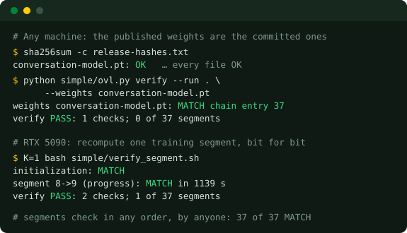

# OpenVerifiableLLM: <br/> Language models you can check yourself

<p align="center">
  
</p>

<p align="center">
  <a href="#why-openverifiablellm">Why?</a> |
  <a href="#goals">Goals</a> |
  <a href="#project-status">Status</a> |
  <a href="#how-it-works">How it works</a> |
  <a href="#getting-started">Getting started</a> |
  <a href="#join-us">Join us</a>
</p>

<p align="center">
  <a href="https://scorecard.dev/viewer/?uri=github.com/AOSSIE-Org/OpenVerifiableLLM"></a>
  <a href="BestPracticesChecklist.md"></a>
  <a href="https://discord.gg/hjUhu33uAn"></a>
  <a href="LICENSE"></a>
</p>

**First release:** a 23M-parameter model trained on one exact pass over all of English Wikipedia,
with every one of its 37 training segments recomputed bit for bit.
[Get it on Hugging Face](https://huggingface.co/datasets/AOSSIE/openverifiable-enwiki-20260901-20260918-r1-evidence/tree/main/release/simple-run).

<a href="docs/guides/check_a_segment.md">

</a>

**Checkable, not just published**

-   Every training checkpoint is published and hash-linked
-   Anyone can recompute any segment and get the same bits
-   The training data rebuilds byte for byte from the raw Wikipedia dump

**Cheap to check, in parallel**

-   One segment takes about 20 minutes on one GPU, about a dollar rented
-   Segments are independent: many people, any order, at the same time
-   A one-click checker on RunPod prints one line to share

**Small and readable**

-   One file trains, verifies, forks and chats: `simple/ovl.py`
-   Timestamped by two independent authorities
-   Open data, open code, open results, GPL-3.0

<br clear="right"/>

## Why OpenVerifiableLLM?

Most model releases ask you to trust a list of datasets and a training description. You can't
check either: training is expensive, nondeterministic, and happens on someone else's machines.
That matters more as models are used for decisions, and as questions about what a model was
trained on (copyright, privacy, contamination of benchmarks) become legal and scientific
questions rather than marketing ones.

OpenVerifiableLLM makes the training itself the evidence. The run is cut into segments. Each
segment boundary commits to the full model and optimizer state, the exact position in the data,
and the previous boundary. Training is made deterministic, so recomputing a segment from its
published starting checkpoint gives exactly the same bits. Anyone with the same GPU type can
therefore check any part of the run without trusting the publisher, and checking all parts
verifies the whole computation.

Because the record pins the exact data position, it also allows things that are normally
impossible to show. For example, a model can be proven never to have trained on a given article:
the run is forked, the article removed, and the removal recorded in the chain.

## Goals

We are building OpenVerifiableLLM to support:

-   Training runs where every step can be recomputed and compared bit for bit
-   Training data traceable to its raw public source
-   Exact coverage: which data was seen, in which order, exactly once
-   Checks that are cheap, independent and parallel
-   Records that can't be quietly rewritten
-   Code simple enough to review in an afternoon

We also have explicit _non-goals_:

-   Proving a model's answers are correct. We verify the computation, not the content
-   Bit-exact results across different GPU architectures
-   Large models before the method is shown on small ones

See [goals](docs/project/goals.md) for the full list and the principles behind it.

## Project status

The first verified model is **released**. It is small (23M parameters): it writes fluent,
encyclopedia-style text, often gets facts wrong, and holds a basic conversation. The method is
the point, and it carries over unchanged to bigger models.

What has been shown:

-   **37 of 37 segments** recomputed bit for bit on a second RTX 5090. Also from public files
    only, on fresh machines: segments 8 and 21
-   **Data provenance**: the training data rebuilt from the raw 2026-09-01 Wikipedia dump is
    byte-identical
-   **Robustness**: a host failure, a mid-run code change and a driver change all happened during
    training, and every affected segment still matched
-   **Verifiable unlearning**: a fork that provably never saw one article, with the exact effect of
    that article measured
-   **Hardware scope**: RTX 5090 reproduces the bits; RTX 4090, H100 and CPU do not

Open limitations:

-   Checkers need the training GPU's architecture (RTX 5090)
-   All checks so far were run by the project, on separate machines. **We need independent
    checkers**: see [Join us](#join-us)

For the full results, cost, timeline and lessons learned, see
[the simple run](docs/design/simple_run.md). For what's next, see the
[roadmap](docs/project/roadmap.md).

## How it works

```text
 raw Wikipedia dump ──rebuild──▶ prepared tokens ──┐
                                                    ▼
 entry 0 ─▶ entry 1 ─▶ entry 2 ─▶ … ─▶ entry 37     chain.jsonl: each entry hashes the full
   │          │          │                │          model + optimizer state, the data
 ckpt 0     ckpt 1     ckpt 2    …     ckpt 37       position and the previous entry

 check segment k:  load ckpt k ─▶ train to boundary k+1 ─▶ compare with entry k+1, bit for bit
```

-   **Determinism**: BF16 autocast with FP32 master weights, deterministic CUDA kernels, no TF32,
    a fixed cuBLAS workspace, and a learning rate that is a pure function of the step
-   **Exact coverage**: every step checks that its data continues exactly where the last one
    stopped, and each phase must end with every item covered once
-   **Timestamps**: every chain entry is stamped by two RFC 3161 authorities as it is written

Details: [the simple run](docs/design/simple_run.md#how-it-works).

## Getting started

Check the released model without a GPU:

```bash
pip install huggingface_hub torch numpy rfc8785==0.1.4 tokenizers==0.23.2 mwparserfromhell==0.7.2 \
  "safetensors>=0.4.5,<1.0" "pynacl>=1.5,<2.0"
hf download AOSSIE/openverifiable-enwiki-20260901-20260918-r1-evidence \
  --repo-type dataset --include "release/simple-run/*" --exclude "*/ckpt-*" --local-dir ovl
cd ovl/release/simple-run
sha256sum -c --ignore-missing release-hashes.txt
OVL_DEVICE=cpu python code/simple/ovl.py verify --run . --weights conversation-model.pt
# weights conversation-model.pt: MATCH chain entry 37
```

Recompute a training segment on an RTX 5090, in one click:
[deploy the RunPod template](https://console.runpod.io/deploy?template=mai1ozh35g), wait about an
hour, and read the result line in the logs. Step by step:
[check a training segment](docs/guides/check_a_segment.md).

Learn more:

-   [The simple run](docs/design/simple_run.md): method, results, cost, timeline, lessons
-   [Goals](docs/project/goals.md), [roadmap](docs/project/roadmap.md) and
    [FAQ](docs/project/faq.md)
-   [The `ovllm verify` artifact verifier](docs/guides/ovllm_verify.md) and the reproducibility
    study
-   [Run the model in Ollama](docs/guides/ollama.md): `ollama run ryoari/openverifiablellm`
-   [All docs](docs/README.md)

### Repository layout

| Path | What it is | Status |
|---|---|---|
| [`simple/`](simple/README.md) | The verifiable training loop: `ovl.py` (train, verify, fork, chat), segment checks, timestamps, the data rebuild. Start here | active |
| [`docs/`](docs/README.md) | Design, project and guide docs | active |
| `tests/` | Tests. `tests/simple/` covers `simple/ovl.py` and runs on a CPU | active |
| `src/ovllm.py`, `src/verifier.py`, `src/publish.py` | The [`ovllm verify` artifact verifier](docs/guides/ovllm_verify.md) | active |
| `src/` (other modules), `run_experiment.py`, `sweep.py`, `demo.py`, [`RUNBOOK.md`](RUNBOOK.md) | The July 2026 reproducibility study and its runbook | reference |
| `notebooks/`, `experiments/`, `paper/`, `data/` | Study notebooks, the paper draft, a small sample dataset | reference |
| `proofs/`, `keys/` | Recorded audit results and the study's public signing key | evidence |
| `project/` | Published evidence, source commitments and technical reports. Pinned by hash: don't edit | evidence |
| `src/ovl_pipeline/`, `scripts/`, `requirements/*.lock` | The earlier production pipeline and its locked environments. The simple run uses its data preparation | frozen |
| `Legacy/` | The pre-GSoC codebase | frozen |
| [`docs/legacy/`](docs/legacy/) | Superseded planning notes | frozen |
| [`brand/`](brand/Brand.md) | Logo, colours and typography | active |
| [`MAINTAINERS.md`](MAINTAINERS.md), [`BestPracticesChecklist.md`](BestPracticesChecklist.md) | Who maintains the project, AOSSIE best-practices status | active |

## Join us

-   **Check a segment.** Have access to an RTX 5090, or a dollar for an hour of one? Run the
    [one-click check](docs/guides/check_a_segment.md#one-segment-one-click) and post the result
    line. Every independent check makes the release more credible
-   **Contribute.** Read [CONTRIBUTING.md](CONTRIBUTING.md). New work targets `simple/` on `main`
-   **Talk to us** on the [AOSSIE Discord](https://discord.gg/hjUhu33uAn) or in
    [GitHub issues](https://github.com/AOSSIE-Org/OpenVerifiableLLM/issues)

OpenVerifiableLLM is an [AOSSIE](https://aossie.org) project, licensed under
[GPL-3.0](LICENSE). Community standards follow AOSSIE's
[code of conduct](https://github.com/AOSSIE-Org/.github/blob/master/CODE_OF_CONDUCT.md) and
[security policy](https://github.com/AOSSIE-Org/.github/blob/master/SECURITY.md).
